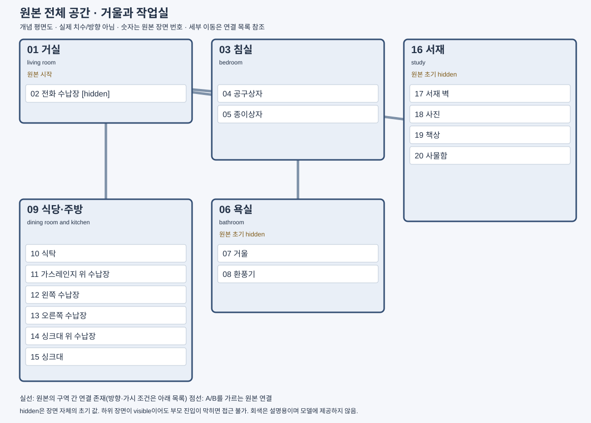
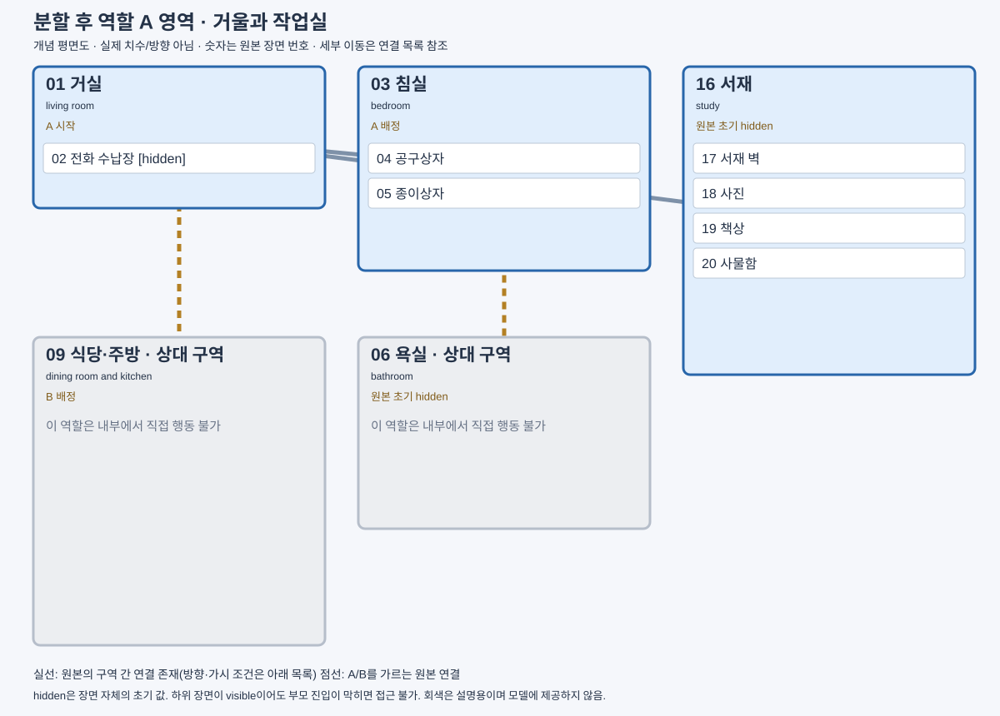
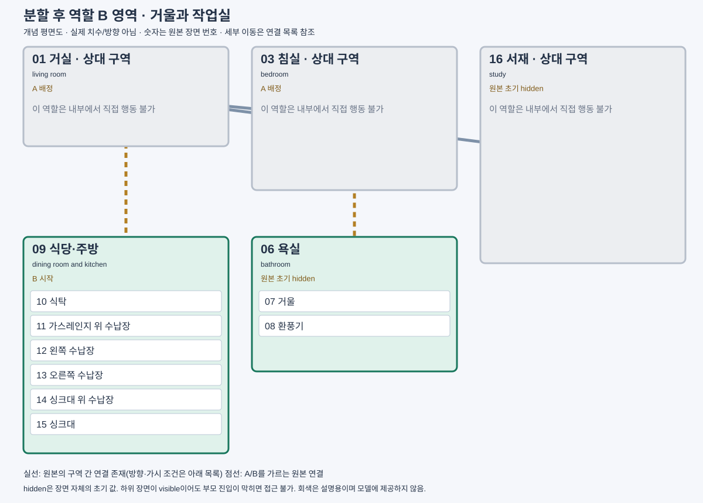
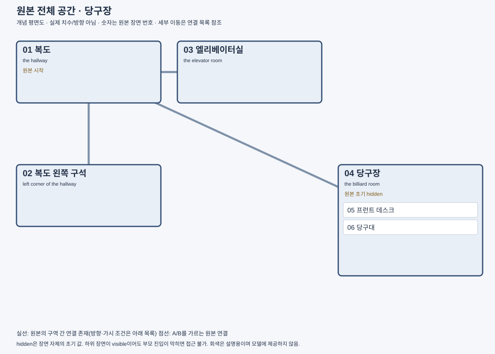
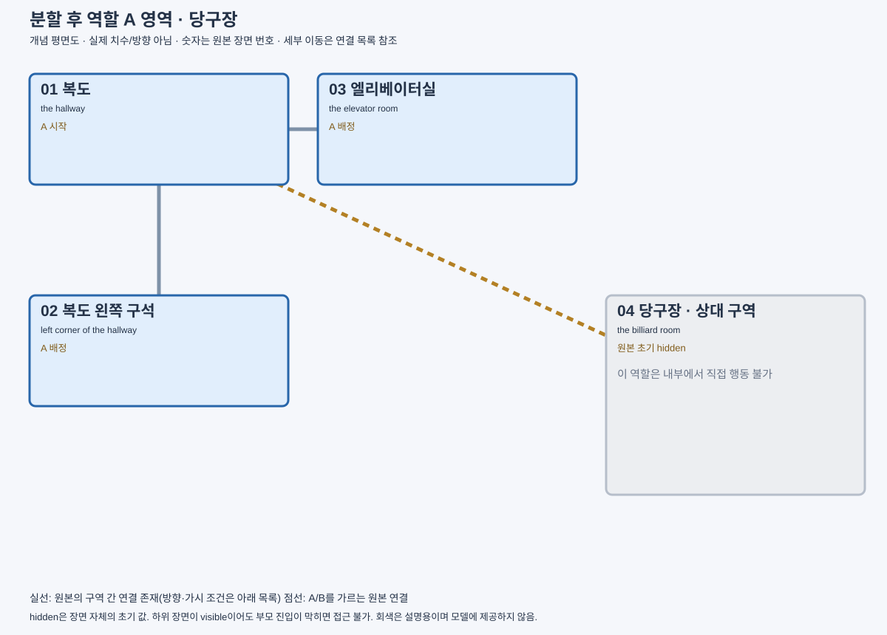
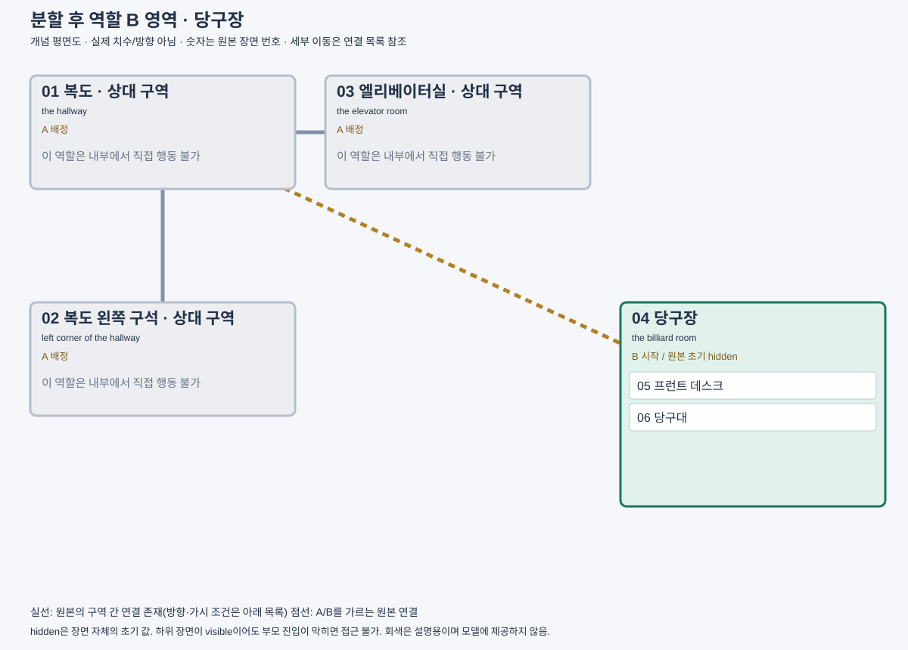
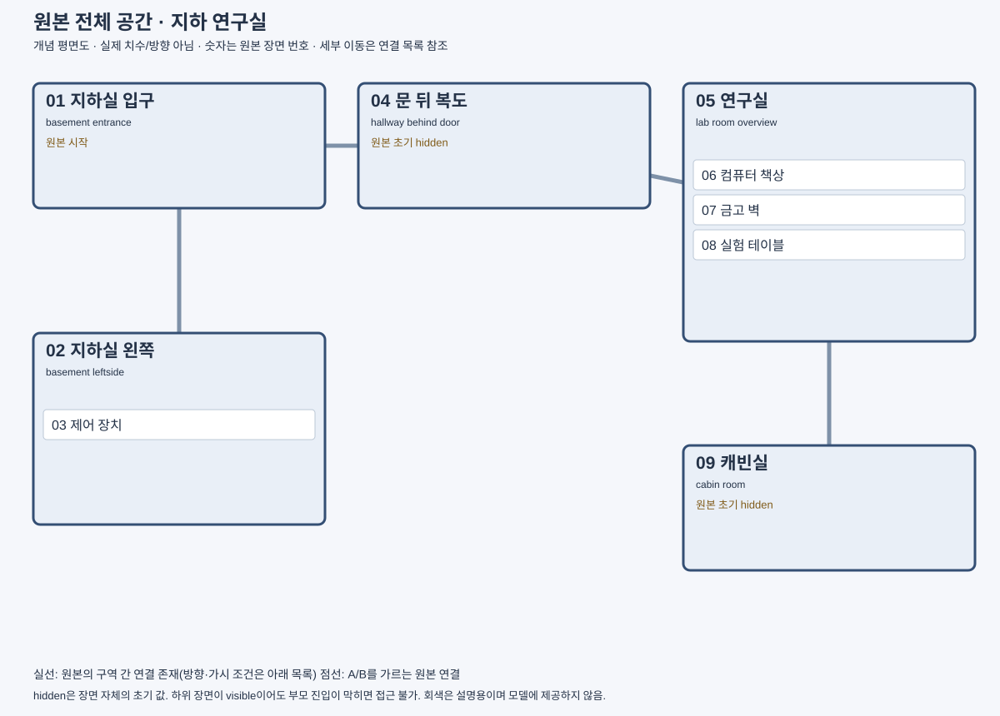
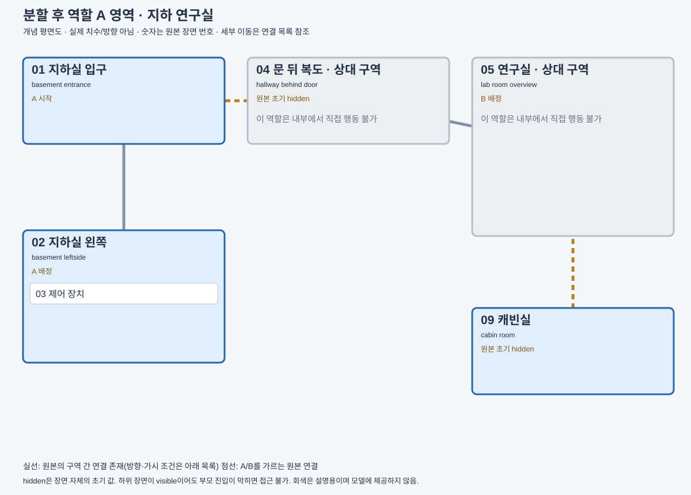
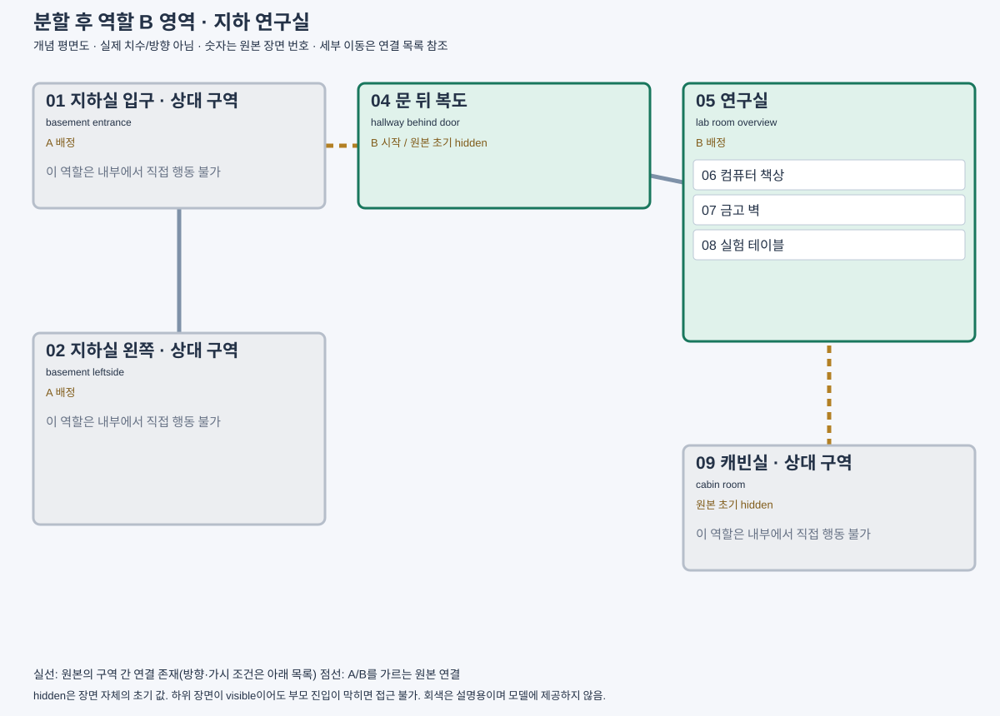

# 협력형 EscapeBench: 현재 설계와 데이터셋 적합성 검토

- 작성 기준: 2026-11-19, 현재 로컬 코드와 누적 실험·분석
- 실행 프로토콜: `escapebench-adaptive-v7`
- 새 실행 결과 폴더: `nightly-v6`
- 장면 분할 버전: `data/roles/`의 `v3` — 실행 프로토콜 v7와 별개
- 범위: 원본 기본 문제 12개의 easy 설정
- 문서 목적: **무엇을 구현했고, 왜 그렇게 했으며, 어떤 문제를 협력 평가에 사용할지** 정리한다.

> 현재 구현과 권고를 구분한다. **핵심 6개·확장 4개·비협력 대조군 1개·제외 1개**는 `data/cohort_policy_v1.json`에 보존한다. 현재 보고서는 이 독립 분류를 사용해 핵심·확장 평균을 각각 계산하고, 분류 버전·해시·사본을 저장한다. 과거 run의 동결된 `split_audit.json`은 참고 증거로 보존하지만 분류의 기준으로 사용하지 않는다. nightly 배열 인덱스는 유지하되 원본 결함 1-4의 두 조건은 모델 로딩 전에 건너뛴다. 모델당 실제 실험은 22개다.

## 현재 상태 요약

| 구분 | 현재 상태 |
|---|---|
| 데이터 | 고정 원본 easy 12개, 장면별 A/B 분할 v3 |
| 주 비교 | 같은 분할 환경의 Solo 중앙 통제 vs 같은 모델 두 문맥의 Peer |
| 실제 실행 | 1-4 제외 11게임 × 2조건 × Qwen3-14B/Phi-4 = 44에피소드 |
| 분석 단위 | 게임별 Solo/Peer 한 쌍; 핵심 6개와 확장 4개 별도 집계, 당구장 대조군 |
| 모델 생성 | NF4 4비트, greedy, native thinking 끔, 출력 256 / 전체 문맥 8192, GPU batch 1 |
| 행동·기억 | 500환경 행동/1000판단, Peer 연속 4판단, 역할당 저장 기억 9,000자 |
| 도움 | 본 실험 무힌트; 50행동 정체 시 도움은 별도 옵션 |
| 버전 | 실행 v7 / 분할 v3 / generation 2 / cohort-policy-v1 / 결과 nightly-v6 |
| 검증 의미 | 정답 경로 재생·형식·기억 검사 통과. 협력 능력 및 데이터 적합성의 최종 검증은 아직 아님 |

**읽는 순서:** 1–3절은 분할 배경과 규칙, 4–7절은 실행 조건, 8–10절은 측정과 문제 분류,
11–13절은 한계와 검증, 14절은 파일 위치, 15절은 진행 중인 서버 실험,
16절은 대표 세 문제의 원본/A/B 지도다. 장면별 원문 배정은 부록 A에 있다.

[대표 3문제 평면도 열기](figures/room-atlas.html) · [서버 실행/다운로드 안내](../server/README.md) · [과거 설계 아카이브](archive/README.md)

## 1. 연구 목적과 비교의 의미

서로 다른 정보를 가진 에이전트가 탐색하고, 상대가 필요로 하는 정보·물건을 발견하고, 전달하고, 사용하여 공동 목표를 해결하는 능력을 측정한다. 정보를 처음부터 완성된 형태로 나누어 주는 과제와 달리, **탐색을 통해 필요한 정보 자체를 찾아야 한다**는 점이 중심이다.

현재 핵심 비교는 다음과 같다.

- **Solo:** 한 컨트롤러가 분할된 A/B의 양쪽 현재 관측과 저장 기억을 보고, 공용 가방으로 양쪽을 조종한다.
- **Peer:** 같은 모델의 두 역할이 각자의 관측·기억·가방을 갖고 메시지와 물건 교환으로 해결한다.
- **original_solo:** 원본 단일 시작 위치·가방·BaseAgent를 사용하는 별도 참조 조건이다. 현재 Solo와 동일한 조건이 아니다.

Solo–Peer 차이에는 정보 접근, 기억 구성, 물건 전달 비용, 의사결정 분산, 행동 순서 선택이 함께 포함된다. 따라서 이를 **분산 협업의 전체 비용**으로 해석한다. 현재 두 조건만으로 순수 통신 능력이나 추론 능력의 인과 효과를 분리할 수는 없다.

Solo는 관측·가방·행동 위치 선택에서 이점을 갖는 중앙 통제 기준선이다. 역할별 기억 선택 규칙은 Peer와 동일하게 적용하고 Solo에는 A/B의 선택 결과를 합쳐 제공한다. 그러나 더 긴 입력과 선택 부담을 가지므로 모든 모델·문제에서 실제 점수가 Peer보다 높아야 한다는 수학적 보장은 없다. Peer가 앞서면 역할 분담의 이점, 탐색량, 진행률 구성, 도움 여부와 실행 오류를 먼저 확인한다.

## 2. 원본 데이터에서 가져온 것과 바꾼 것

원본은 로컬에 고정한 EscapeBench 저장소를 사용한다.

- 경로: [`vendor/escapebench/`](../vendor/escapebench/)
- 고정 커밋: `2d42347446a8e9ed4f058fa415d40afa194166a5`
- YAML: 장면 설명, 물체·도구 상태, 행동 전이, 장면 연결, 성공 피드백
- 정답 로그: 주요 행동의 참조 순서와 위치
- 기본 행동: `click`, `apply`, `input`, `move`, `craft`
- 전역 진행률 카운터와 원본 종료 피드백

현재 주 실행은 원본 YAML을 원본 퍼즐 엔진에 읽고, 그 위에 역할별 관측·이동·가방·통신·스케줄·기억 계층을 추가한다. 초기 개발용 `data/pilot/`의 JSON 환경을 현재 모델 실험에 직접 사용하는 구조가 아니다.

원본 객체와 상태 전이를 보존했다는 것은 **원본의 모든 풀이 행동이 분할 후에도 반드시 필요하다는 뜻은 아니다.** B를 잠긴 방 안에서 시작시키면 원래 그 방을 열기 위한 행동이 선택 사항이 될 수 있다. 이 차이는 데이터셋 적합성 검사에서 따로 다룬다.

| 요소 | 원본 참조 조건 | 현재 협력 평가 |
|---|---|---|
| 공간 | 단일 플레이어가 원본 그래프를 이동 | 장면을 A/B에 배정, 두 위치 유지 |
| 시작 | 원본 시작 위치 하나 | A는 원본 시작, B는 자기 구역 내부 |
| 관측 | 현재 장면·가방 | Solo 양쪽 현재 관측, Peer 자기 관측 |
| 가방 | 하나 | Solo 공용, Peer 역할별 |
| 행동 | 원본 5종 | Peer에 send/give/yield 추가 |
| 기억 | 최근 행동 중심 | 관측·수신·피드백 저장 + 최근 행동 |
| 파서 | 응답 내 마지막 함수 호출 추출 | 명시된 `Action:` 한 줄의 외부 명령 |
| 도움 | 정체 시 정답 도움 | 기본 없음, 별도 도움 옵션 |
| 종료 | 원본 최종 탈출 행동 | 동일한 원본 탈출 목표 |

**두 개의 출구를 모두 여는 조건은 구현하지 않았다.** 하나의 원본 탈출 목표를 팀이 달성하면 종료한다. 탈출과 진행률 100%는 별개다.

## 3. 장면을 나눈 방법과 이유

### 3.1 초기 수작업에서 현재 탐색 방식으로

초기 8개 파일럿은 원본 의존성을 읽고 수작업으로 나누는 과정에서 출발했다. 이후 원본 과정 복원, 역할 유휴·장면 파편화·협업 필요성 검사를 거쳐 현재는 **명시적 제약과 점수로 후보 분할을 탐색하는 방식**을 사용한다.

현재 `scripts/make_roles.py`에는 이전 탐색의 1위 분할을 저장한 목록이 들어 있다. 따라서 지금 파일의 목록은 고정돼 있지만, 선택 근거는 `scripts/search_splits.py`의 규칙이다. 단서–정답 연결 주석은 사람/작성자의 해석이 들어간 별도 자료이며, 전체 파이프라인이 완전 자동으로 의존성을 발견하는 것은 아니다.

### 3.2 분할 단위

1. 원본 시작 장면은 A에 둔다.
2. 클로즈업 같은 하위 장면은 가능한 한 부모 공간과 묶는다.
3. 나머지 공간 묶음을 A/B에 배정해 후보를 만든다.
4. B는 자기 영역 중 원본 시작점과 그래프상 가까운 장면에서 시작한다. 거리 계산은 잠금을 무시한다.

목표는 상대 방의 서랍 내부만 B 소유가 되는 식의 부자연스러운 분할을 줄이고, 양쪽이 초반부터 탐색할 수 있게 하는 것이다. 다만 현재의 A/B는 각각 **여러 장면으로 이루어진 접근 구역**이다. 모든 문제가 물리적으로 완전히 분리된 방 두 개인 것은 아니다.

### 3.3 후보 선택 기준

탐색기는 대략 다음 조건을 사용한다.

- 물건 교환을 허용하면 원본 검사와 같은 수준의 참조 행동을 완료할 수 있을 것.
- 각 역할이 상대 행동 없이 참조 행동의 최소 약 10%를 수행할 수 있을 것.
- 가능하면 전체 참조 행동의 15% 이상이 물건 전달 없이는 완료되지 않을 것.
- 교차 암호 단서가 있는 분할을 우선할 것.
- 역할별 작업량 불균형, 여러 조각으로 끊긴 영역, 과도한 물건 전달을 줄일 것.

이 중 ‘혼자 수행할 수 있는 행동 수’ 검사는 정답을 이미 아는 상태였다. 따라서 **단서를 모르는 실제 에이전트의 초기 진행 가능성**과 다를 수 있다. 세탁실의 B가 대표적인 사례다.

또한 물건 의존 링크 수는 참조 경로에서 도구의 발견·사용 역할이 다른 연결 수다. 같은 물건을 한 번 전달해 여러 곳에서 사용할 수도 있으므로 실제 최소 전달 횟수와 같지 않다.

### 3.4 이동과 시작 위치의 정확한 의미

- 역할은 자기 소유 장면에서만 행동한다.
- 원본의 보이는 상대 구역을 통과하여 연결되는 자기 구역은 이동 대상으로 연결할 수 있다. 이 경로 축약 때문에 원본 이동 횟수와 달라질 수 있다.
- B의 시작 방이 원본에서는 잠겨 있어도 B는 그 안에서 시작한다. 그 방의 외부 문이 모두 열린 것으로 바꾸지는 않는다.
- 원본 장치의 원격 효과는 유지된다. A의 문 개방이 B의 접근 가능 구역을 바꿀 수 있다.
- `give`는 위치·거리 조건 없이 즉시 전달한다. 해치는 현재 구체적인 장소로 구현한 것이 아니라 통신·전달 인터페이스의 추상화다.

## 4. Solo와 Peer의 실행 규칙

| 항목 | Solo | Peer |
|---|---|---|
| 의사결정 | 한 컨트롤러 | 역할별 독립 문맥, 같은 모델 |
| 현재 관측 | A/B 양쪽 | 현재 행동 역할만 |
| 저장 기억 | 양쪽 기록 통합 | 자기 관측·피드백·수신 내용 |
| 가방 | 실제 Bag 객체 하나 공유 | A/B 별도 |
| 행동 위치 | 매 판단에서 A/B 선택 | 스케줄러가 정한 현재 역할 |
| 연속 실행 | 자유롭게 같은 쪽 선택 | 최대 4판단 |
| 통신·전달 | 불필요, send/give 불허 | send/give 허용 |
| 양도 | yield 불허 | yield로 이번 기회만 넘김 |

Solo가 A에서 열쇠를 수집하면, 다음 판단에 B를 선택해서 바로 사용할 수 있다. 역할 선택은 같은 모델 응답에 포함되므로 별도 추론 호출이 없다. 사용·소모·조합은 하나의 가방을 갱신하므로 물건이 복제되지 않는다.

Peer는 두 모델을 동시에 GPU에 상주시킬 필요가 없다. 같은 모델 가중치를 사용하면서 역할별 관측과 기록을 분리해 순차 호출한다. 판단 문맥을 공유하지 않기 때문에 역할 분리가 유지된다.

### 4.1 강제 교대를 없앤 이유

A가 막혔을 때 B가 연속 탐색할 수 있어야 하며, A/B에 같은 수의 턴을 강제로 줄 필요가 없다. 비교할 예산은 팀 전체의 행동·판단 비용이다.

Peer의 동작은 다음과 같다.

- 기본적으로 현재 역할이 계속한다.
- 최대 4판단 후 상대에게 기회를 준다. 오류도 판단 수에 포함된다.
- 유효한 `yield()`, 성공한 `send`·`give`는 즉시 상대에게 넘긴다.
- 양도한 역할을 대기 상태로 영구 비활성화하지 않는다.
- 양쪽이 연속 양도해도 그것만으로 종료하지 않는다.
- 실패했다고 자동으로 ‘할 일 없음’으로 판정하지 않는다.

‘지금 이 자물쇠를 못 연다’와 ‘자기 영역에서 더 탐색할 곳이 없다’를 구분하기 위해서다. 연속 상한 4는 무한 독점을 막는 현재 기본값이며, 최적값으로 실증된 것은 아니다. 다른 상한의 효과를 보려면 별도 조건으로 비교해야 한다.

### 4.2 비용과 종료

기본 nightly는 **500환경 행동 + 최대 1000판단**을 사용한다.

| 행위 | 환경 행동 비용 | 판단/추론 |
|---|---:|---|
| 이동·조사·수집·사용·조합 | 1 | 보통 1회 모델 호출 |
| send/give | 1 | 1회 모델 호출 |
| Peer의 유효한 yield | 0 | 1판단·모델 호출 |
| 잘못된 명령·실패한 시도 | 1 | 모델 호출 기록 |
| Solo의 역할 선택 | 행동에 포함 | 추가 호출 없음 |
| 행동하지 않는 상대 | 0 | 호출 없음 |
| 도움 옵션의 강제 행동 | 1 | 모델 호출 없음 |

종료는 원본 탈출, 환경 행동 예산 소진, 판단 예산 소진, 인프라 중단·오류로 구분한다. 판단 수와 모델 호출 수는 강제 행동이 있는 도움 조건에서 달라질 수 있다. yield는 무한 무료 추론 통로가 되지 않도록 판단 상한을 둔다.

## 5. 관측과 기억

모델에는 전체 환경 JSON을 그대로 보내지 않는다. 현재 상태에서 실제로 보이는 장면·물체 설명, 사용할 수 있는 대상과 이동 라벨, 가방 도구 설명을 **텍스트**로 만든다.

### 5.1 현재 관측

- 원본 장면의 현재 설명과 보이는 물체·도구
- 현재 조작할 수 있는 대상 이름
- 현재 이동 가능한 장면의 정확한 이동 라벨
- 현재 가방의 도구와 상태 설명

숨은 물건, 미방문 장면 전체, 정답 경로, 평가용 단서 연결은 제공하지 않는다. Solo도 양쪽의 현재 위치를 볼 뿐 전체 맵을 전지적으로 보는 것은 아니다.

### 5.2 저장 기억

예전 구현은 최근 행동의 위치·명령·결과만 기억했다. 장면에서 눈으로 본 단서는 이동 직후 기억에서 사라질 수 있었다. 이를 보완해 다음을 저장한다.

1. 역할별로 실제 본 장면의 **마지막 관측**과 시점
2. 역할별 수신 메시지·물건 전달 업데이트
3. 새 key step을 완료한 행동의 결과인 발견 기록(누적 원본 보존, 프롬프트에는 예산 내 선택)
4. 위치·행동별 마지막 피드백
5. 역할별 최근 10행동의 위치·명령·피드백·수신 내용

저장 기록은 역할별·범주별로 선택한다. 두 조건에 동일한 정책을 적용한다.

| 범주 | 역할 하나당 문자 한도 | 선택 규칙 |
|---|---:|---|
| 과거 장면 관측 | 4,000 | 현재 제공하는 장면 제외; 과거 행동 메뉴를 제외한 설명; 최근순 완전 항목 |
| 발견 기록 | 3,000 | 새 key step을 완료한 행동(첫 click/apply/input 전이, 조합)의 결과 문구; 덮어쓰지 않음; 최근순 |
| 받은 내용 | 1,500 | 같은 내용은 최신 수신만 유지; 최근순 |
| 행동 피드백 | 500 | Error/Nothing happens로 시작하는 피드백과 발견 기록 제외; 최근순 |

Peer는 자기 역할의 최대 9,000자, Solo는 같은 규칙으로 선택한 A/B를 합친 최대 18,000자를 받는다.

**발견 기록을 따로 두는 이유.** 2-2의 교차 암호 `1040`은 서랍을 여는 순간의 결과 문구("The drawer is opened, and there is a paper with a number "1040"")에만 나온다. 그 뒤 서랍 설명은 "an opened drawer"로 바뀌고 다시 조작할 수 없다. 12개 문제의 교차 암호 단서 중 결과 문구에만 있는 것은 이것 하나다. 일반 피드백(500자, 2–3개)에 두면 곧 밀려나고, 같은 위치·행동을 다시 시도하면 오류 문구로 덮어써진다. 그래서 엔진의 key step 카운터가 오른 행동만 별도 목록에 쌓고 덮어쓰지 않는다. 판정은 엔진이 원래 진행률에 쓰는 카운터를 그대로 쓰며 단서 주석은 사용하지 않는다. 도구 수집은 가방 설명에 이미 나오므로 제외한다. 저장 문구에서 click/apply/input의 행동 반복 문장은 인자로 재구성해 정확히 일치할 때 지운다. 성공 표식은 문자열 치환하며 craft의 기존 도구 설명 반복 줄은 접두어로 제거하고, 조합 결과 설명은 남긴다. 즉 모든 제거가 인자 기반 일치인 것은 아니다. 2026-11-19 합법 이동 재검사에서는 11게임 모두 탈출했지만 2-3의 원본 이동 연결이 없는 선반 참조 행동 1개는 건너뛰었다. 이는 전체 참조 행동 재생 성공과 다르다. 9게임은 발견 기록 선택에서 제외된 항목이 없었고, 실행 중 최대 제외 수는 1-5 A=1, 2-3 A=3/B=14였다. 2-2는 서랍 개방 이후 60개 판단 프롬프트 모두에 `1040`이 남았다. 재현은 `python3 -m scripts.check_protocol --output outputs/protocol-check.json`, 근거는 [protocol-v7-check.json](evidence/protocol-v7-check.json)이다. 이전 cl100k 약 6.5k 측정은 실제 모델의 문맥 한도 증명이 아니다. 현재 로컬에는 실제 모델 토크나이저가 없어 토큰 수는 미확인이다. 서버 제출/준비 시 `--tokenizer 모델폴더`로 실제 채팅 템플릿과 토크나이저를 사용해 같은 경로를 검사한다. 각 범주의 여유 공간을 오류 피드백이 가져가지 않는다. 최근 10행동 기록에는 오류도 유지해 같은 실수를 알아볼 수 있게 한다. 전체 원본 기록은 계속 로그에 보존한다.

현재 관측은 매 판단 저장하지만 저장 기억에서 다시 표시하지 않는다. 현재 장면은 CURRENT VIEW에 한 번 나타난다. 선택 항목 수·제외 수·시점·문자 수는 `memory_selection`에 기록한다. 현재 관측·최근 행동·가방·헤더는 이 저장 기억 한도 밖에 추가되므로 전체 8192토큰 한도와는 별개다. 실제 모델 토크나이저로 문맥 초과를 검사하며 자동으로 숨겨 자르지 않는다.

기존 v6는 Solo의 A/B 기억을 합쳐 12,000자로 제한하면서 Peer에는 각자 12,000자를 줬다. 현재 관측 중복과 오류 피드백의 공간 점유까지 있어 중앙 통제 비교의 교란 요인이었다. v7은 역할별 동일 정책으로 수정했다. 다만 Solo 입력이 더 길고 선택해야 할 행동이 더 많다는 부담은 남는다.

저장 관측은 **관측 당시의 스냅샷**이다. A가 떠난 방을 B가 바꾸었다고 A의 저장 관측을 자동 갱신하지 않는다. 전역 상태 변경은 평가 로그에 기록하지만 숨은 변화 전체를 모델에 통지하지 않는다. 재방문과 메시지를 통해 새 상태를 알아야 한다.

## 6. 프롬프트의 구성과 이유

### 6.1 시스템 프롬프트

원본 `BASE_SYS_PROMPT_COT`의 기본 행동 설명을 토대로 다음을 추가한다.

- Solo 또는 Peer의 정보 접근·가방·행동권 규칙
- 새로운 상태·도구·단서가 생기면 재방문·재시도를 고려하라는 지침
- 저장 기억이 과거 관측이라는 설명
- 출력 형식과 메시지 길이 제한
- 환경 행동 비용과 판단 예산의 구분

새 퍼즐의 정답을 알려주는 지시가 아니라, 에이전트가 실행 환경을 정확히 이해하기 위한 규칙이다. 원본의 ‘왕복을 피하라’는 문구는 상황 변화 시 재방문을 허용하는 문구로 바꿨다. 원본의 무조건적인 반복 회피 문구도 제거하고, 상태 변화 없이 같은 실패를 반복하지 말라는 조건부 지시로 통일했다.

### 6.2 매 판단의 사용자 메시지

기본 도움 없음 조건의 구성은 다음과 같다.

```text
현재 판단 번호 / 사용한 환경 행동 수 / 판단 상한
Solo: A/B 중 역할 선택 안내
Peer: 현재 역할 안내

저장 관측·발견 기록·수신·피드백 (시점 표시, 최근순, 범주별 선택 한도)
역할별 최근 행동 기록
현재 관측 (Solo A+B, Peer 자기 쪽)
현재 가방 (Solo 공용, Peer 자기 가방)
```

현재 관측의 중복은 과거 v6에서 매 판단 발생했다. v7에서는 현재 장면을 저장 기억 표시에서 제외한다. 별도 기억 요약 LLM이나 지능적인 조정자는 사용하지 않는다.

### 6.3 출력 예시

Solo:

```text
Thought: B의 현재 장면에 자물쇠가 있고 공용 가방에 열쇠가 있으므로 사용한다.
Role: B
Action: apply(key, cabinet)
```

Peer:

```text
Thought: 상대가 필요한 장치의 사용법을 전달한다.
Action: send(Please use apply(key, cabinet) on your side.)
```

`Thought`는 모델이 출력한 짧은 설명이다. 내부 사고 전체를 관찰한 것이 아니며, 이것만으로 모델이 실제로 무엇을 이해했는지 단정하지 않는다.

현재 시스템 프롬프트는 Solo에 Thought–Role–Action의 정확히 세 줄, Peer에 Thought–Action의 정확히 두 줄을 지시한다. 원본의 공통 두 줄 지시는 제거했다. 따라서 지시대로 출력했는데 Solo만 Role 누락으로 예산을 잃던 형식 충돌을 해결했다.

### 6.4 명령과 메시지 처리

과거에는 응답 전체에서 마지막 함수 호출을 골랐다. 그래서 메시지 안의 `apply(...)`를 실제 명령으로 실행하는 오류가 있었다. 현재 경로는 명시적인 `Action:` 한 줄의 외부 명령을 해석한다.

- Action 줄이 없거나 여러 개이면 잘못된 명령으로 처리한다.
- send 본문의 괄호와 행동 예시는 문자열로 취급한다.
- 300자 초과 메시지는 일부만 보내지 않고 오류를 반환한다.
- 자동 정답 교정·무료 재질문은 하지 않는다.
- Solo의 send/give/yield, 잘못된 Role은 유효한 행동이 아니다.
- 함수명·대상·이동 라벨 등 형식 요구가 남아 있다. 자연어 의미가 비슷하다는 이유로 정답 행동으로 바꾸지 않는다.

## 7. 모델과 도움 조건

현재 nightly 모델은 Qwen3-14B와 Phi-4 14B다. 이전 8B·32B 실험은 이 프로토콜의 결과로 자동 편입하지 않는다.

| 설정 | 현재 nightly |
|---|---|
| 백엔드 | HF Transformers / 현재 GPU 실행 경로 |
| 정밀도 | NF4 4비트 |
| 배치 | 1 |
| 생성 | `do_sample=False`, `num_beams=1`, 출력 1개 |
| 최대 새 토큰 | 256 |
| 전체 문맥 상한 | 8192토큰 |
| Qwen native thinking | 비활성화 |
| 사고 출력 | 짧은 Thought 설명 |
| 기본 도움 | 없음 |

코드의 GenerationConfig에는 `temperature=1.0`, `top_p=1.0`, `top_k=50`이 기록된다. **샘플링을 끈 greedy이므로 이것을 temperature 1의 확률적 샘플링 실험이라고 해석하면 안 된다.** 실제 생성 모드와 설정을 검사·기록한다. 문맥 초과는 조용히 잘라 진행하지 않고 오류로 기록한다.

이 조건은 원본 논문의 완전한 재현이 아니다. 모델, 양자화·백엔드, 문맥, 기억, 스케줄, 도움 정책이 다르다. 원본 비교용 경로의 설명은 [ORIGINAL_PROTOCOL.md](ORIGINAL_PROTOCOL.md)를 참고한다.

### 도움 옵션

`--help-policy original`을 명시하면 분할 환경에 맞춘 도움을 사용한다.

- 약 50환경 행동 동안 점수가 오르지 않으면 다음 참조 목표를 제시한다.
- 목표 위치 이동과 정답 행동 공개가 포함된다.
- 같은 도움 목표에서 10회째에는 모델 대신 행동을 강제 실행한다.
- Peer에서는 필요한 물건 전달이 도움 목표가 될 수 있다.
- Solo는 공용 가방이므로 전달 도움을 만들지 않는다.
- 현재 기억을 도움 중에도 제공한다.

이는 이름이 original이어도 원본 단일 플레이의 모든 인덱스·스케줄 동작을 그대로 복제한 조건은 아니다. 도움 결과는 자율 해결과 분리해 보고한다.

## 8. 측정과 실패 분석

### 주 측정

- 같은 팀 환경 행동 예산에서의 진행률
- 원본 탈출 성공 여부
- 판단 수·모델 호출 수·입출력 토큰
- 역할별 행동 수, 방문 장소, 오류·양도·메시지·전달
- 도움 사용 여부와 강제 행동 수

진행률은 `(원본 key_steps + 수집 도구 수) / (전체 key_steps + 전체 도구 수)`다. 메시지 전송만으로 점수가 오르지 않는다. 물건 수집과 체크포인트의 합이므로, 같은 진행률이라도 협업 내용이 다를 수 있다.

예산 집계는 JSONL 줄 수가 아닌 환경 행동 비용을 누적해 자른다. 중단·오류·판단 예산 소진으로 해당 환경 예산까지 관측되지 않은 경우는 결측으로 다룬다. 탈출이 먼저 발생하면 그 결과를 이후 예산에 유지하되, 탈출 당시 진행률을 임의로 100으로 만들지는 않는다.

### 단서·물건 연결의 분석

제안서의 발견→전송→활용을 다음과 같이 확장한다.

| 정보 단서 | 물건 |
|---|---|
| 실제 관측했는가 | 수집했는가 |
| 필요한 내용을 전달했는가 | 필요한 쪽에 전달했는가 |
| 받은 정보를 목표에 사용했는가 | 필요한 대상에 사용했는가 |

현재 자동 분석은 **검토 후보 라벨**이다. 문자열 포함 여부가 올바른 이해·전송을 증명하지 않으며, 부정문·불완전한 설명·이미 아는 정보·선행 조건을 고려해야 한다. 상태 변화나 접근 실패도 세 단계만으로 설명되지 않는다.

Solo에는 전송·전달 의무가 없으므로 협업 전송 실패 라벨을 부여하지 않는다. 여러 단서가 같은 게임의 한 사슬에 속하면 독립 표본으로 세지 않는다. 특히 연구실의 세 암호 입력은 하나의 왕복 정보 흐름에 연결돼 있다.

추가된 영구 기억에 들어 있는 오래된 단서를 기존 분석기가 전부 추적한다고 가정해서는 안 된다. 실제 `generation.messages`와 보존 기록을 함께 확인하고, 새 기억 구조에 대한 라벨 검증이 필요하다.

## 9. 데이터 적합성 검사의 발전

### 9.1 정답 재생 검사

원본·분할 엔진에서 정답 행동을 실행해 탈출할 수 있는지 검사했다. 이는 상태 전이와 도구 전달 구현의 검증이다. **정답을 모르는 사람이 단서를 따라 풀 수 있다는 증거는 아니다.**

### 9.2 정답 사전지식 우회 검사

`scripts/audit_split_paths.py`는 정답을 알고, 도달 가능한 장소 사이 이동 비용을 생략하고, 일부 역할의 중간 행동을 빼도 탈출하는지를 검사한다. 거울·당구장·연구실·창고가 표시됐다.

하지만 정답을 알면 출구 암호를 알아내는 과정 자체를 생략할 수 있다. 따라서 이 표시만으로 협력 부적합을 판정하면 안 된다. 이전의 4문제 일괄 제외는 보수적인 임시 필터였고, 현재 집계에서는 독립된 최종 분류로 대체했다.

### 9.3 실제 관측 단서를 요구하는 검사

`scripts/analyze_suitability.py`는 현재 보이는 물체·도구 설명, 관측 가능한 행동 결과에 주석의 단서가 등장했을 때만 그 암호 입력을 허용한다.

- 원본 단일 플레이
- 분할 후 정보·물건 공유 허용
- 메시지 없이 물건 전달만 허용
- 물건 전달 없이 정보 공유만 허용
- A만 또는 B만 행동

위 조건들을 비교했다. 정보 해석과 참조 행동은 알고 있으며, 도달 가능한 장면은 무료로 살펴본다는 낙관적인 가정이 있다. 메시지 없는 조건에서도 종이 같은 단서 도구의 물리적 전달은 가능하다.

결과적으로 원본·분할 모두 11문제에서 완료 경로를 찾았다. `game1-4`는 원본에서도 단서 순환 때문에 막혔다. 당구장은 메시지 없이도 완료됐고 마지막 물건 전달이 남았다. 나머지 문제들은 이 검사에서 정보 교류나 물건 교환을 제거하면 완료되지 않았다.

**완료 경로를 못 찾았다는 사실은 모든 대안 경로가 불가능하다는 증명이 아니다.** 주석의 누락·과도한 선행 조건, 참조 행동 외 해법, 정답 추측을 별도로 검토해야 한다.

## 10. 최종 권고 분류

아래는 현재 확보한 근거에 따른 분석 결과다. ‘핵심’도 모델 검증이 완료된 확정 벤치마크라는 뜻은 아니다.

| 문제 | 교차 암호 입력 / 물건 링크 | 권고 | 협력의 핵심과 한계 |
|---|---:|---|---|
| 1-1 거울·작업실 | 3 / 6 | 핵심 | A 조각→B 거울→A 도구상자, A 벽·램프→B 금고→A 출구. 양방향 연쇄가 명확 |
| 1-2 병원·엘리베이터 | 1 / 8 | 확장 | 출입증·종이·부품·드릴의 왕복. 23장면과 분리된 B 구역으로 탐색 부담 큼 |
| 1-3 당구장 | 0 / 1 | 비협력 대조군 | B가 내부를 해결하고 마지막 카드만 A에 전달. 현재 B 시작이 A의 진입 과정을 불필요하게 만듦 |
| 1-4 주방·숨겨진 방 | 1 / 6 | 원본 수정 전 제외 | 출입카드 뒤에 공개되는 암호가 그 카드 획득에 먼저 필요함 |
| 1-5 기숙사·제어실 | 2 / 11 | 확장 | B 필름·약품→A 현상→B 암호. A 12장면/B 3장면으로 작업량 불균형 |
| 2-1 아파트·서재 | 3 / 4 | 핵심·기초형 | 코드와 물건의 양방향 전달. 복합 추론보다 전달 기본 능력에 적합 |
| 2-2 상점·사무실 | 3 / 7 | 핵심 | 양방향 코드·도구 교환, 최종 XOR에 양쪽 자료와 규칙 결합 |
| 2-3 오두막 | 4 / 13 | 확장·고난도 | 다중 표·색·도형·암호·조합. 35장면·95참조행동으로 기억·형식 부담 큼 |
| 2-4 지하 연구실 | 3 / 4 | 핵심 | B 소리·주파수→A 검출기→B 출구. 정보를 처리한 결과를 되돌려줌 |
| 2-5 밴 | 4 / 10 | 핵심 | 발전기·전구·물·외부 단서·USB의 왕복. A가 외부뿐 아니라 앞쪽 실내도 소유 |
| 3-1 창고 | 3 / 10 | 확장 | 배송목록·PUK·도구·해금의 상호 의존. 21장면·72참조행동으로 길고 전달이 많음 |
| 3-2 세탁실 | 4 / 5 | 핵심 | A 티켓→B 점수→A 종이→B 사무실. B는 초반 A 공급에 의존 |

### 10.1 당구장을 대조군으로 사용하는 이유

실제 엔진에서 정답을 아는 스크립트로 A가 사진만 반복 조사하다가 마지막 카드로 출구를 여는 경로를 재현했다. 73행동, 전달 1회, 힌트 0, 진행률 71.05%에서 탈출했다. 비용 없는 폐쇄 검사만의 결과가 아니다. 다만 과거의 A/B 교대 스케줄에 대한 알려진 정답 경로이며, v7 모델 성능이나 최소 행동 수 주장이 아니다.

재현: `python -m scripts.reproduce_billiards_bypass --output experiments/evidence/billiards-bypass`

[재현 요약](evidence/billiards-bypass/summary.json), [73행동 전체 로그](evidence/billiards-bypass/turns.jsonl), [고정 역할 배정](evidence/billiards-bypass/roles.json)을 보존했다. 요약에 실행 코드·원본·참조 로그 해시와 원본 커밋을 기록한다.

현재 분할에서는 A의 중간 퍼즐이 탈출에 필수가 아니다. ‘협업 부담이 거의 없을 때도 Peer가 불필요한 통신 비용을 쓰는가’를 보는 대조군으로 유용하다. 다른 분할까지 모두 불가능하다고 입증한 것은 아니다.

### 10.2 주방 문제의 원본 순환 의존

```text
7049로 keypad safe 열기
→ buttons → cabinet → chisel
→ block of ice → piece of ice → 가열 → swipe card
→ front door에 카드 사용
→ 문에 7049 표시
```

원본 YAML에서 `7049`를 알아내는 정상 단서가 그 암호를 먼저 써야 얻는 카드 뒤에 놓여 있다. 원본과 분할 모두 관측 기반 검사에서 막혔다. 강제 정답 재생의 성공은 이 문제를 해결하지 못한다. 수정하려면 원본과 구분되는 별도 데이터 버전 및 수정 근거가 필요하다.

### 10.3 거울·연구실·창고를 일괄 제외하지 않는 이유

세 문제는 최종 암호를 미리 안다는 가정 때문에 이전 검사에서 경고됐다. 그러나 단서를 관측해야 한다는 조건을 추가하면 상대의 정보·물건을 필요로 하는 연쇄가 남는다. 따라서 거울·연구실은 핵심, 창고는 긴 확장 과제로 권고한다.

### 10.4 초기 공급 의존성이 큰 네 문제

| 문제 | 관측 단서를 요구할 때 B 단독 참조 행동 | 전체 대비 |
|---|---:|---:|
| 2-1 | 2/45 | 4.4% |
| 2-2 | 5/66 | 7.6% |
| 3-1 | 6/72 | 8.3% |
| 3-2 | 0/48 | 0% |

정답을 아는 분할 검색의 최소 10% 조건과 실제 관측 가능한 단서 조건은 다르다. 네 문제는 초기 공급 의존형으로 표시한다. 점수를 얻는 참조 행동이 적다는 뜻이며 탐색·관측·요청할 일이 없다는 뜻은 아니다. 핵심 세 문제도 이 비대칭을 가지므로 최초 교환 전 진행·요청·양도 비용을 따로 분석한다.

### 10.5 핵심 문제별 통신 병목 위치

| 핵심 문제 | 메시지 제거 시 완료되지 않은 참조 행동 / 전체 | 비율 |
|---|---:|---:|
| 2-1 | 32/45 | 71.1% |
| 2-2 | 43/66 | 65.2% |
| 3-2 | 29/48 | 60.4% |
| 1-1 | 13/40 | 32.5% |
| 2-5 | 11/58 | 19.0% |
| 2-4 | 3/57 | 5.3% |

이는 관측 단서 기반 참조 검사치이며 실제 모델의 진행률 손실 추정치가 아니다. 물건으로 단서를 전달할 수 있다는 조건도 포함한다. 연구실은 crow·130·2463의 세 입력만 남는 후반 통신 병목형이다. 왕복 정보 구조는 유지되지만 전체 진행률만으로는 통신 실패를 거의 드러내지 못하므로, 탈출 성공과 연결된 최종 목표의 해결 여부를 함께 본다. `cohort-report.md`는 등급·모델·예산별로 Solo/Peer 탈출 수(완전한 쌍 기준)를 진행률 평균 옆에 표시하고, 게임별 행에도 @500 탈출 여부를 표시한다. 탈출은 원본 최종 탈출 행동이 해당 환경 행동 예산 안에서 성공한 경우다. 핵심 평균 외에 이런 유형별 결과를 표시하며 사후적으로 좋은 문제만 선택하지 않는다.

### 10.6 오두막의 94/95

추가 재검사: 원본 kitchen의 scene_relations에는 `shelf above food preparation area close-up`으로 들어가는 연결이 없다. 현재 합법 이동 참조 재생에서는 그 장면의 click 1개를 생략하고 탈출한다. 확장군 결과의 참조 행동 완전성과 관측 단서 충분성을 구분해야 하며, 원본 YAML은 수정하지 않았다.

관측 기반 검사에서 원본과 분할 모두 95개 참조 행동 중 94개를 완료하고 탈출했다. 누락된 것은 참조의 `click(left door of the shelf above food preparation area)`로, 해당 검사에서 별도 점수 증가로 잡히지 않았다. 이 숫자만으로 분할이 원본 퍼즐 하나를 삭제했다고 판단하지 않는다.

## 11. 제안서와 현재 구현의 차이

| 제안서의 표현 | 현재 상태와 필요한 정리 |
|---|---|
| 완전히 분리된 두 방 | 여러 장면으로 이루어진 두 접근 구역 |
| 모든 단서는 잠금과 다른 방 | 일부 교차 의존만 생성, 방 안에서 푸는 퍼즐도 존재 |
| 대화·해치로만 상호작용 | 원본 장치의 원격 상태 효과도 유지; give는 위치 제한 없음 |
| 두 출구 모두 열기 | 원본 최종 목표 하나로 팀 탈출 |
| Solo vs Peer가 정보 분할 비용 | 가방·통신 비용·스케줄·문맥 차이도 포함 |
| 모든 실패가 3단계 중 하나 | 환경 접근·도구·형식·기억·원본 오류 등 별도 원인 존재 |
| Oracle 비교 | 현재 주 실행에는 Oracle 미구현 |
| LLM Oracle로 비용 분해 | 파트너 오류·스케줄·예산 통제가 필요하며 현재 검증되지 않음 |

제안서는 현재 구현에 맞춰 고쳐야 한다. 또는 제안서의 더 강한 조건을 만족하도록 데이터를 재구성하고 별도 검증해야 한다. 이 문서는 현재 구현을 설명하며 제안서의 모든 주장이 달성됐다고 가정하지 않는다.

## 12. 누적 실험을 해석하는 방법

이전 결과는 다음 변경을 거쳤다.

1. 초기 축약 JSON 파일럿과 원본 과정 복원
2. 원본 단일 플레이를 Solo로 비교하던 단계
3. 같은 분할 환경에서 양쪽 관측을 받는 중앙 Solo로 수정
4. Solo의 불필요한 요청 제거, 이후 공용 가방 도입
5. 자유로운 Solo 위치 선택과 Peer 연속 행동·양도
6. 관측 기억, 엄격한 명령 파싱, 기본 무힌트 평가 도입

따라서 이전 버전의 높은/낮은 점수를 현재 프로토콜의 증거로 그대로 합치면 안 된다. 이전 로그에서 얻은 것은 실패 원인과 설계 수정 근거다.

- Peer 초기 진행률 우위는 독립적인 두 위치의 수집 진척 때문일 수 있었다.
- 짧은 기억에서 사라진 단서를 모델의 추론 실패로 해석할 위험이 있었다.
- 메시지 속 행동 예시의 오파싱을 협력 실패로 해석할 위험이 있었다.
- 힌트 이후 탈출은 독립 해결과 구분해야 했다.
- CUDA 오류·OOM·시간 제한·문맥 초과는 능력 점수 0으로 넣지 않는다.
- 구 Solo의 원본 단일 시작 환경과 새 Solo의 분할 두 위치 환경은 다른 조건이다.

프로토콜 v7은 사용자 서버에서 실행을 시작했다(15절). 현재 제공된 것은 사전 검사와 첫 에피소드 중간 로그이며, 완료된 44회 비교 결과는 아직 확인하지 않았다. 새 결과에 대해 모델별 협력 능력이 검증됐다고 주장하지 않는다.

## 13. 검증 상태와 남은 작업

### 확인된 범위

- 2026-11-19: 관련 회귀 검사 21개 통과(발견 기록·집계·실제 채팅 템플릿 계산·문맥 한도 게이트 포함). 전체 검사 실행에서는 웹 테스트 setUpClass만 샌드박스의 로컬 소켓 바인딩 제한으로 오류, 3개 조건부 테스트는 생략됐다. 전체 테스트 완전 통과를 주장하지 않는다. 제외 대상은 미실행 결측과 구분해 보고한다.
- 새 Solo/Peer에서 12문제의 정답 도움 경로 완료
- 역할 선택·양도·가방 상태를 포함한 로그 재생/재개
- 메시지 내부 행동 예시를 외부 명령으로 실행하지 않는 처리
- 환경 행동과 판단 예산을 구분한 집계
- 원본/분할의 관측 단서 기반 적합성 선별

### 아직 남은 범위

- 원본 `game1-4` 순환 단서 처리: 제외 유지 또는 별도 수정판 설계
- 나머지 후보의 비용 있는 실제 경로 및 주석·대안 풀이 검토
- 역할별 범주 기억 선택과 8192토큰 문맥의 실제 모델 입력 분포 확인: 제출 전 토크나이저 검사 추가, 모델이 생성하는 전체 경로의 길이는 실행 로그로 별도 확인
- 새 영구 기억에 맞는 실패 단계 라벨 검증
- 스케줄 상한, 역할 시작 순서·배정에 대한 민감도 확인
- Oracle 설계와 구현, 인간 라벨 검증

## 14. 코드·데이터·결과의 위치

| 목적 | 파일 |
|---|---|
| 새 실행 규칙·프롬프트·기억·스케줄 | [`scripts/adaptive_escape.py`](../scripts/adaptive_escape.py) |
| 역할별 이동·가방·통신의 기반 | [`scripts/coop_original.py`](../scripts/coop_original.py) |
| 공용 가방 기반 | [`scripts/central_solo.py`](../scripts/central_solo.py) |
| 실행·저장·재개·생성·설정 동결 | [`scripts/run_matrix.py`](../scripts/run_matrix.py) |
| CPU 정답 경로·토크나이저 검사 | [`scripts/check_protocol.py`](../scripts/check_protocol.py) |
| nightly 작업 목록 | [`scripts/run_nightly.py`](../scripts/run_nightly.py) |
| 환경 행동 예산 집계 | [`scripts/run_cohort.py`](../scripts/run_cohort.py) |
| 분할 후보 생성 | [`scripts/search_splits.py`](../scripts/search_splits.py) |
| 고정 분할 목록 | [`scripts/make_roles.py`](../scripts/make_roles.py) |
| 분할 파일 | [`data/roles/`](../data/roles/) |
| 암호–단서 주석 | [`data/clues.json`](../data/clues.json) |
| 이전 보수적 우회 검사 | [`data/split_audit_v6.json`](../data/split_audit_v6.json) |
| 관측 단서 기반 적합성 검사 | [`scripts/analyze_suitability.py`](../scripts/analyze_suitability.py) |
| 버전별 최종 분류 | [`data/cohort_policy_v1.json`](../data/cohort_policy_v1.json) |
| 최신 상세 결과·분류 | [`outputs/analysis/cooperation-suitability.json`](../outputs/analysis/cooperation-suitability.json) |
| 협업 근거 추적 | [`scripts/analyze_collaboration.py`](../scripts/analyze_collaboration.py) |
| 최초 제안서 | [`proposal.md`](../proposal.md) |

적합성 검사는 `data/cohort_policy_v1.json`에서 분류와 근거를 읽어 결과 JSON의 assessment/recommendation에 포함한다. 검사 재실행으로 수동 분류가 사라지지 않는다. 보고서는 `--classification`으로 분류 파일을 명시할 수 있고 `cohort-policy-used.json`에 선택한 정책과 해시를 남긴다. 다른 분류로 재집계해도 환경 상태·모델 응답 로그는 바꾸지 않는다.

실행 로그에서는 `generation.messages`가 모델에 실제 제공된 정보의 기준이다. `observed_memory`, `evaluation`, `world_changed_scenes` 등 평가 기록이 로그에 있다는 이유만으로 모델이 그 내용을 모두 봤다고 판단하면 안 된다.

## 15. 진행 중인 서버 실험과 확인된 결과

이 절은 **2026-11-19 사용자가 전달한 로그** 기준이다. 실시간 서버 상태를 조회한 결과가 아니다.

| 작업 | 확인된 상태 | 의미 |
|---|---|---|
| Qwen 배열 861126 | 첫 요소 861126_0 실행, 개별 Job ID 861127 | 1-1 Solo가 200행동까지 진행 |
| Phi 준비 861128 | COMPLETED, ExitCode 0:0, 28분 10초 | 모델 재사용, 토크나이저·GPU 실행 사전 검사 완료 |
| Phi 배열 861129 | 마지막 squeue에는 Dependency 대기 | 준비 성공 조건은 충족. 이후 실제 시작 여부는 추가 조회 필요 |

Qwen은 모델 로딩 548초, 100행동과 200행동에서 진행률 27.5%, hints=0이었다.
이는 그 구간의 정체를 보여주며 최종 실패·탈출 여부를 뜻하지 않는다. 판단당 평균 약
5초였지만 길어진 입력, 다른 게임, 서버 I/O에 따라 처리 시간은 달라진다.

Phi 준비는 1-3/2-4 × Solo/Peer의 네 에피소드를 70행동 예산으로 실행해 280회 호출을
검사했고 `passed=true`였다. 출력의 `step_budget`은 사전 검사 예산 종료다. 이 실행은
본 500행동 실험에 합쳐 집계하지 않는다. `mean_batch_size=4.0`은 한 스케줄러 주기에
모인 네 에피소드 요청 수다. 코드가 `max_batch=1` 크기로 나눠 생성하므로 GPU에
네 입력을 동시에 넣었다는 뜻은 아니다.

모델별 배열 24슬롯 중 제외 게임 1-4의 2슬롯은 실행 없이 종료한다. 한 모델에서 최대
한 요소만 GPU를 점유하고, 두 모델/준비 작업을 합쳐 최대 두 GPU를 사용한다. 문제마다
자원을 다시 배정받으며 각 본 작업의 Slurm 상한은 11시간 30분, 러너 상한은 40,200초다.
전체 44회 완료 시간은 대기열 때문에 12시간을 넘을 수 있다. 학습은 하지 않는다.

Qwen은 개인 홈의 `models/Qwen3-14B`, Phi는 연구실 개인 폴더의 `models/phi-4`를 사용한다.
현재 결과 위치는 `/shared/s2/lab04/gyeonghwankim/escape-lab/outputs/nightly-v6`이다.
`experiment.json`에 코드·데이터·설정 해시를 동결하고 동일 조건의 재개만 허용한다.
모델 응답·행동은 `turns.jsonl`, 최종 상태는 `summary.json`, 합산은 `cohort-report.md`에 기록한다.
현재 실행 중인 코드·분할·프롬프트를 덮어쓰지 않는다. 이번 문서·지도 작성은 실험 엔진을 변경하지 않았다.

실제 Qwen과 Phi 토크나이저로 11개 Solo 참조 경로의 입력 길이 검사가 모두 PASS했다.
이 검사는 임의의 모델 행동·메시지·오류가 쌓인 모든 경로의 문맥 상한을 보장하지 않는다.
실제 실행의 입력/출력 토큰, 문맥 오류와 잘림 여부를 최종 로그에서 별도로 점검해야 한다.

## 16. 대표 3문제의 원본과 A/B 개념 평면도

[브라우저 비교 지도](figures/room-atlas.html)는 문제별 독립 탭으로 구성한다. 선택한 문제만 표시하며 페이지 내 위치 이동이나 이미지 새 창 열기는 사용하지 않는다.

- **물건·단서 연결:** 원본의 모든 물체·도구를 장면 안에 표시한다. 물건을 누르면 정확한 배치 위치·초기 설명·관련 사용처를 보여주고 출발과 도착을 선으로 잇는다. YAML의 apply/조합 대상과 물건 공개 전이, `data/clues.json`의 단서 활용 관계를 구분한다. A/B 교차·전체·선택한 위치의 관계를 필터링한다.
- **Solo 탈출 경로:** 현재 v7 중앙 Solo의 검증된 정답 재생을 이전/다음·슬라이더·행동 목록으로 살펴본다. 거울 84행동, 당구장 51행동, 연구실 74행동 모두 원본 종료 조건에 도달했다. 이동·도구 사용·암호 입력·조합과 행동 후 공용 가방·A/B 위치·진행률을 표시한다. 이는 모델 실행 로그나 최단 경로가 아니다.
- **Peer 탈출 경로:** 같은 v7 엔진에서 정상 스케줄·합법 이동·분리 가방·give/send/yield를 사용한 정답 재생이다. 거울 118판단/97환경 행동(메시지 4·전달 7), 당구장 64/52(메시지 0·전달 1), 연구실 98/80(메시지 3·전달 3)으로 모두 탈출했다. 중앙 스크립트는 정답 행동 순서와 단서 주석을 알고 있으며, 전송 문구는 보내는 역할의 실제 입력에 있는 공개 설명에서만 가져왔다. 자율 모델의 협력 성능이나 최소 교환 경로를 뜻하지 않는다. 원본 행동 순서를 따라가므로 당구장의 더 짧은 우회 증인과도 구분한다.
- **판단별 프롬프트:** Solo/Peer 경로의 각 판단 직전 system/user 문자열을 캡처한다. 현재 관측·가방 부분과 전체 프롬프트를 각각 열람한다. 위 경로 가방·진행률은 행동 후 기록이고 프롬프트는 행동 전 입력이다. 이 재생에서는 모델을 호출하지 않지만, 실제 실행과 같은 프롬프트 생성 코드를 사용했다.
- **실제 모델 로그 뷰어:** 서버에서 받은 `turns.jsonl`을 브라우저에서 선택하면 `generation.messages`와 생성 원문·환경 피드백을 그대로 표시한다. 파일을 외부로 전송하지 않으며 지도 재생과 별도의 턴 선택을 사용한다. 강제 행동 등으로 generation이 없는 턴은 입력 없음으로 표시하고 만들어내지 않는다.
- **공간 보기:** 원본 공간의 중립 색상, A/B 분할 색상, A 또는 B 강조를 전환한다. 원본 공간으로 바꾸어도 Solo 재생은 같은 분할 환경의 경로이며 원본 단일 플레이 경로로 바뀌지 않는다.

지도에는 숨은 물건을 포함한 전체 정의가 표시된다. Solo 단계에서 갱신되는 것은 위치·가방·피드백·진행률이며, 지도 전체가 당시 모델 관측을 재현하는 것은 아니다. 정답 경로 탭에는 실제 암호 입력도 노출된다. 실험 프롬프트에 넣지 않는다. 아래 9장은 문서용 정적 평면도다.

**도면을 읽는 법:** 데이터에는 좌표·치수·층 구조가 없으므로 위치와 방 크기는 설명용이다.
큰 박스는 주요 공간, 내부 작은 칸은 원본 클로즈업 장면이다. 모든 원본 장면을 한 번씩
포함했다. 선은 주요 공간 사이의 원본 연결 존재만 표시하며 방향·가시 조건·세부 연결은
브라우저에서 각 위치를 선택하면 나가는 원본 연결을 확인할 수 있다. 같은 공간이라도 원본 이동은 방향별로 다를 수 있다.
A/B 그림은 같은 좌표를 유지하고 다른 역할 구역을 회색으로 표시했다. 회색 내부는 실제
모델 관측에 제공되지 않는다. 점선은 분할 경계의 원본 연결이며 새 문이나 전달 해치를
추가한 것이 아니다. 잠금은 scene.visible만으로 모두 표현되지 않는다.

### 16.1 거울과 작업실 1-1 — 양방향 연쇄

20장면을 A 10개/B 10개로 배정했다. A는 거실에서, B는 식당·주방에서 시작한다.
A는 거실·침실·서재, B는 주방·욕실을 맡는다. B의 두 영역은 원본 그래프에서 떨어져
있으며 상태에 따라 A 구역을 거치는 이동 축약이 적용된다. 욕실·서재 등은 원본 초기
가시 조건이 남아 있어 시작부터 모든 내부를 볼 수 있는 것은 아니다.

A의 거울 조각 → B의 거울 복원 → A의 공구상자,
A의 서재 벽·램프 정보 → B의 금고 → A의 최종 출구라는 연쇄가 있다.
교차 암호 입력은 3개, 참조 물건 의존 링크는 6개다. 정답 문자열은 정적 평면도에서 생략했다. 브라우저의 Solo 정답 경로에는 실제 입력 명령이 포함된다.





### 16.2 당구장 1-3 — 분할 시작으로 우회가 생기는 대조군

6장면을 복도·엘리베이터 쪽 A 3개, 당구장 내부 B 3개로 나눴다.
원본은 복도에서 당구장 진입을 해결해야 하지만, 분할에서는 B가 당구장 내부에서 시작한다.
따라서 내부의 연쇄를 B 혼자 수행한 뒤 `key card 2`를 A에 주는 경로가 남는다.
교차 암호 입력 0개, 물건 링크 1개여서 정보 협력의 주 지표에 넣지 않는다.
원본 일부 행동이 불필요해지는 효과를 확인하는 대조군이다.





### 16.3 지하 연구실 2-4 — 후반 정보 왕복

9장면을 A 4개/B 5개로 나눴다. A는 지하실 입구, B는 문 뒤 복도에서 시작한다.
A의 캐빈실은 원본 연결상 B 연구실 너머에 있으므로, 분할은 물리적으로 연속된 방 두 개와
일치하지 않는다. B의 소리·주파수 목록을 A의 파형 검출기에 활용하고, 그 결과를 다시
B의 철문에 쓰는 왕복 정보 의존이 있다. 교차 암호 입력 3개, 물건 링크 4개다.

관측 단서 기반 검사에서는 메시지 없이 남는 병목이 마지막 3/57행동이었다.
초기 진행률이 비슷하다고 통신이 필요 없는 문제라고 해석하면 안 되며, 후반 링크 해결과
탈출 여부를 함께 봐야 한다. 같은 key card의 두 사용처는 링크 2개지만 최소 전달 2회를 뜻하지 않는다.





지도는 `python3 -m scripts.build_room_atlas`로 다시 생성한다. 입력은 원본 YAML과
현재 roles JSON, 단서 주석과 Solo 재생 기록이며, 한글 장면명과 도면 배치는 설명용으로 작성했다. HTML 화면 소스는 `scripts/room_atlas_template.html`, Peer/Solo 경로·입력 캡처는 평가자용 `scripts/replay_atlas.py`에 있다. 실험 엔진이나 서버 실행 조건은 바꾸지 않는다. 실제 코드에서
동적으로 계산하는 모든 잠금·원격 상태 변화를 한 정적 도면으로 대체하지 않는다.

## 부록 A. 실제 장면 배정

아래 목록은 문서 작성 시 `data/roles/*.json`에서 가져온 정확한 장면 이름이다. 각 문제의 A 시작은 원본 첫 장면이며 B 시작은 별도 지정돼 있다.

### game1-1-easy

- A 시작: `living room`
- B 시작: `dining room and kitchen`
- A 장면: `living room`, `telephone cabinet close-up`, `bedroom`, `toolbox close-up`, `cardboard box close-up`, `study`, `wall close-up`, `photo close-up`, `desk close-up`, `locker close-up`
- B 장면: `bathroom`, `mirror close-up`, `ventilation fan close-up`, `dining room and kitchen`, `dining table close-up`, `cabinet above stove close-up`, `left cabinet close-up`, `right cabinet close-up`, `cabinet above sink close-up`, `sink close-up`
- 참조 행동: 40; 참조 기준 B 몫: 39%; 원본 이동 그래프 내 A/B 연결 조각: 1/2

### game1-2-easy

- A 시작: `hallway`
- B 시작: `room 805`
- A 장면: `hallway`, `blocked path close-up`, `cabinet close-up`, `hallway right`, `small cabinet close-up`, `large cabinet close-up`, `room 805 door view`, `ventilation fan close-up`, `operating room door overview`, `operating room`, `surgical table close-up`, `operating room cabinet close-up`, `upper cabinet close-up`, `lower cabinet close-up`, `anatomy poster close-up`
- B 장면: `elevator room`, `elevator interior`, `room 805`, `desk close-up`, `left bookshelf close-up`, `bedside table close-up`, `right bookshelf close-up`, `805 right room`
- 참조 행동: 45; 참조 기준 B 몫: 40%; 원본 이동 그래프 내 A/B 연결 조각: 1/2

### game1-3-easy

- A 시작: `the hallway`
- B 시작: `the billiard room`
- A 장면: `the hallway`, `left corner of the hallway`, `the elevator room`
- B 장면: `the billiard room`, `front desk`, `pool table`
- 참조 행동: 38; 참조 기준 B 몫: 68%; 원본 이동 그래프 내 A/B 연결 조각: 1/1

### game1-4-easy

- A 시작: `hallway`
- B 시작: `kitchen`
- A 장면: `hallway`, `washroom`, `hidden room`
- B 장면: `kitchen`, `storage room`
- 참조 행동: 64; 참조 기준 B 몫: 40%; 원본 이동 그래프 내 A/B 연결 조각: 2/1

### game1-5-easy

- A 시작: `initial room`
- B 시작: `the dormitory`
- A 장면: `initial room`, `iron fence close-up`, `room on the right`, `distribution box close-up`, `stair`, `the boiler room`, `secret office`, `the bathroom`, `room on the left`, `the control room`, `the emergency exit`, `second floor passage`
- B 장면: `the dormitory`, `bed close-up`, `cabinet close-up`
- 참조 행동: 62; 참조 기준 B 몫: 32%; 원본 이동 그래프 내 A/B 연결 조각: 1/1

### game2-1-easy

- A 시작: `letter`
- B 시작: `corridor`
- A 장면: `letter`, `apartment entrance`, `apartment hallway`, `cloakroom`, `hallway cabinet`, `utility room`, `sanctum`
- B 장면: `corridor`, `world map`, `study room`, `utility room 2`, `bathroom`
- 참조 행동: 45; 참조 기준 B 몫: 41%; 원본 이동 그래프 내 A/B 연결 조각: 2/1

### game2-2-easy

- A 시작: `entrace of a shop`
- B 시작: `inner office`
- A 장면: `entrace of a shop`, `reception room`, `administration office`, `administration office corner`
- B 장면: `inner office`, `right side of inner office`, `left side of inner office`, `store room`
- 참조 행동: 66; 참조 기준 B 몫: 58%; 원본 이동 그래프 내 A/B 연결 조각: 1/1

### game2-3-easy

- A 시작: `outside of the cabin house`
- B 시작: `workspace area`
- A 장면: `outside of the cabin house`, `stairs close-up`, `front door close-up`, `windows close-up from outside`, `living room`, `living room cabinet close-up`, `living room safe close-up`, `toolbox close-up`, `handbook close-up`, `clock and photos close-up`, `living room shelf close-up`, `living room drawer close-up`, `fireplace close-up`, `ceiling door close-up`, `second floor`
- B 장면: `workspace area`, `workspace cabinet close-up`, `desk close-up`, `workspace shelf close-up`, `car photos and map close-up`, `attic`, `attic door close-up`, `fingerprint scanner close-up`, `kitchen`, `shelf above sink close-up`, `mirror close-up`, `drawers below sink close-up`, `shelf above food preparation area close-up`, `drawers below food preparation area close-up`, `sink close-up`, `kitchen door close-up`, `storage room`, `storage room safe close-up`, `storage shelf close-up`, `cellar door close-up`
- 참조 행동: 95; 참조 기준 B 몫: 61%; 원본 이동 그래프 내 A/B 연결 조각: 1/1

### game2-4-easy

- A 시작: `basement entrance`
- B 시작: `hallway behind door`
- A 장면: `basement entrance`, `basement leftside`, `control machine set`, `cabin room`
- B 장면: `hallway behind door`, `lab room overview`, `computer desk`, `wall of safes`, `experiment table area`
- 참조 행동: 57; 참조 기준 B 몫: 48%; 원본 이동 그래프 내 A/B 연결 조각: 2/1

### game2-5-easy

- A 시작: `van in dessert`
- B 시작: `passage way in van`
- A 장면: `van in dessert`, `back of the van`, `underneath part of the van`, `top of the van`, `trunk of the van`, `repair kit in the trunk`, `door of the van`, `van indoor front overview`, `front desk`, `book shelf`, `computer on the desk`
- B 장면: `passage way in van`, `drawers`, `bed overview`, `right side of bed`, `bed shelf inside`
- 참조 행동: 58; 참조 기준 B 몫: 44%; 원본 이동 그래프 내 A/B 연결 조각: 1/1

### game3-1-easy

- A 시작: `warehouse outside`
- B 시작: `middle hallway`
- A 장면: `warehouse outside`, `garbage disposal place`, `crane overview`, `warehouse door corner`, `electric box inside`, `warehouse leftside overview`, `front desk office overview`, `front desk locker`, `left hallway`
- B 장면: `middle hallway`, `boxes pile in hallway`, `office door overview`, `office room overview`, `office room desk`, `office room drawers`, `shelves region overview`, `shelves region table`, `shelves region left`, `shelves region middle`, `control device on pillar`, `wash basin place`
- 참조 행동: 72; 참조 기준 B 몫: 51%; 원본 이동 그래프 내 A/B 연결 조각: 1/1

### game3-2-easy

- A 시작: `laundry room overview`
- B 시작: `left corridor overview`
- A 장면: `laundry room overview`, `laundry room left corner`, `laundry room right corner`, `right corridor overview`, `end of right corridor`
- B 장면: `left corridor overview`, `end of left corridor`, `office room overview`, `office room right side`
- 참조 행동: 48; 참조 기준 B 몫: 53%; 원본 이동 그래프 내 A/B 연결 조각: 1/1
